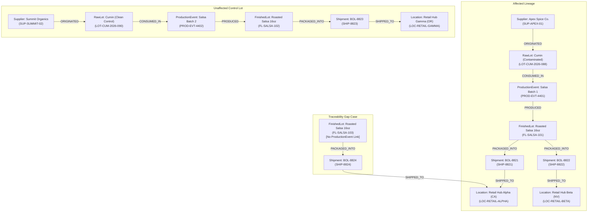

# RECALLMESH: Demonstration Scenario & Acceptance Test Protocol

> **Notice:** All entities, lot identifiers, facility names, and supply chain events described herein are **100% synthetic**. They are designed exclusively for technical demonstration and testing of the RECALLMESH property-graph agent.  
> **Testing Constraint:** Acceptance criteria are defined as formal expectations. **No successful test runs or execution results are fabricated in this document.**

---

## 1. Synthetic Food-Manufacturer Scenario: "Verdant Harvest Foods"

### 1.1 Enterprise Context
**Verdant Harvest Foods** is a synthetic mid-market specialty food manufacturer producing organic salsas, dips, and prepared condiments in Salinas, California (Facility ID: `FAC-SALINAS-01`).

### 1.2 The Crisis Event
On October 15, 2026, Verdant Harvest receives an urgent notification from ingredient supplier **Apex Spice Co.** (`SUP-APEX-01`). An internal pathogen screen detected *Salmonella enterica* in a distributed lot of Organic Ground Cumin: **`LOT-CUM-2026-088`**.

Verdant Harvest QA must immediately determine:
1. Did any of `LOT-CUM-2026-088` get consumed in salsa production?
2. Which finished lots were produced, where were they shipped, and which carriers have them in transit?
3. Are unaffected production lots cleanly isolated from the recall?
4. Are there any unlinked or missing records in the production batch logs?

---

## 2. Graph Topology & Test Dataset Design



### 2.1 Case Entities (Synthetic Dataset Specification)
1. **Contaminated Path (Affected Lineage):**
   * Raw Lot: `LOT-CUM-2026-088`
     * `disposition`: `"QUARANTINED"`
     * `traceability_status`: `"VERIFIED"`
     * Contaminant: *Salmonella enterica* (Synthetic COA lab record `EVID-LAB-904`)
   * Production Event: `PROD-EVT-4401` (Line 2, Oct 12, 2026)
   * Finished Lot: `FL-SALSA-101` (Units: 2,400 jars)
     * Initial `disposition`: `"AVAILABLE"` $\rightarrow$ Post-Investigation `disposition`: `"QUARANTINED"`
     * `traceability_status`: `"VERIFIED"`
   * Shipments:
     * `SHIP-8821`: 1,200 jars to `LOC-RETAIL-ALPHA` (Operational transit disposition: `"IN_TRANSIT"`, Traceability: `"VERIFIED"`)
     * `SHIP-8822`: 1,200 jars to `LOC-RETAIL-BETA` (Operational transit disposition: `"DELIVERED"`, Traceability: `"VERIFIED"`)
2. **Unaffected Control Lot (Surgical Isolation Test):**
   * Raw Lot: `LOT-CUM-2026-090` (Clean, received from `SUP-SUMMIT-02`)
     * `disposition`: `"AVAILABLE"`
     * `traceability_status`: `"VERIFIED"`
   * Production Event: `PROD-EVT-4402` (Line 2, Oct 13, 2026)
   * Finished Lot: `FL-SALSA-102` (Units: 2,400 jars)
     * `disposition`: `"AVAILABLE"`
     * `traceability_status`: `"VERIFIED"`
   * Shipment: `SHIP-8823` to `LOC-RETAIL-GAMMA`
   * *Expected Test Result:* Proves surgical containment. Because it has verified, unbroken provenance linking strictly to clean `LOT-CUM-2026-090`, it is spared from containment.
3. **Traceability-Gap Case (Uncertainty Handling & Missing Records):**
   * Finished Lot: `FL-SALSA-103` (Located in facility cold storage)
     * Initial `disposition`: `"AVAILABLE"`
     * Initial `traceability_status`: `"UNKNOWN"` $\rightarrow$ Evaluated `traceability_status`: `"GAP_DETECTED"`
   * Flaw: Ingested into cold storage without an associated `ProductionEvent` or ingredient transformation record (missing batch log).
   * *Critical Safety Rule:* **The application must NEVER declare a product safe merely because no contaminated graph path was found.** Because `FL-SALSA-103` lacks unbroken transformation records, the system must refuse to certify it as safe, assign an explicit `traceability_status: "GAP_DETECTED"`, and generate an automated QA audit review task (`ACT-AUDIT-03`).

---

## 3. Expected Results Across the Five Dimensions

### 3.1 Dimension 1: Graph Tracing
* **Downstream Forward Trace:** Query starting at `LOT-CUM-2026-088` resolves precisely to `FL-SALSA-101`, `SHIP-8821`, and `SHIP-8822`.
* **Zero False Positives:** Excludes `FL-SALSA-102` from the contaminated lot set based on verified independent lineage.
* **Upstream Reverse Trace:** Query starting at `SHIP-8821` traverses backward through `FL-SALSA-101` and `PROD-EVT-4401` to isolate `LOT-CUM-2026-088` and `SUP-APEX-01`.

### 3.2 Dimension 2: Uncertainty Handling & Absence-of-Path Safety Rule
* **No Path $\neq$ Safe:** If a lot has no path to the known contaminated lot, the agent inspects whether the lot has complete provenance. If records are missing (as in `FL-SALSA-103`), the agent explicitly flags it as `UNKNOWN` / `GAP_DETECTED`.
* **Action Formulation:** The agent formulates an internal quarantine review action (`ACT-AUDIT-03`) to freeze the physical pallet in Salinas pending batch log reconciliation, preventing unverified goods from circulating.

### 3.3 Dimension 3: Approved Simulated Actions (Human-in-the-Loop)
* All containment actions and external notifications are strictly **simulated** (generating sandbox message payloads and audit logs; no live external dispatches occur).
* The agent constructs a draft action plan:
  1. `ACT-QUARANTINE-01`: Issue internal simulated warehouse hold for remaining jars of `FL-SALSA-101`.
  2. `ACT-STOP-SHIP-01`: Draft simulated consignee stop-ship notice to carrier for in-transit `SHIP-8821`.
  3. `ACT-CONSIGNEE-01`: Draft simulated recall notification to Retail Hub Beta for delivered `SHIP-8822`.
* **Mandatory Authorization Gate:** The agent must **refuse** to simulate dispatch until an authenticated QA Director signs off on `DEC-2026-001`.

### 3.4 Dimension 4: Multi-Agent Handoff & Memory
* **Coordinator -> Investigator Handoff:**
  * Intake Coordinator creates `RecallCase` node `CASE-2026-004`.
  * Passes control to Investigator Agent, which records intermediate path traversal findings inside an `AgentMemory` node (`MEM-SESS-01`).
* **Investigator -> Containment Coordinator Handoff:**
  * Containment Coordinator reads `MEM-SESS-01` and the affected subgraph from FalkorDB, synthesizing the action plan without re-running redundant traversals.

### 3.5 Dimension 5: Cross-Session Company Brain Integration
* When the recall case moves to `CONTAINED`, the agent writes a post-incident memory node to the company knowledge graph.
* The supplier node `SUP-APEX-01` has its `risk_rating` property automatically updated from `"LOW"` to `"ELEVATED"`, which triggers mandatory Certificate of Analysis (COA) checks for all future shipments from Apex Spice Co.

---

## 4. Graph-Ablation Test: Proving FalkorDB Indispensability

To prove that FalkorDB's graph topology is strictly required (and that the agent is not using flat hardcoded lists), an automated ablation test is specified:

1. **Ablation Setup:**
   * Execute baseline downstream trace: `LOT-CUM-2026-088` correctly returns `FL-SALSA-101`.
2. **Edge Deletion (Ablation):**
   * Execute Cypher deletion of the single consumption edge:
     ```cypher
     MATCH (r:RawLot {lot_code: 'LOT-CUM-2026-088'})-[rel:CONSUMED_IN]->(p:ProductionEvent {event_id: 'PROD-EVT-4401'})
     DELETE rel;
     ```
3. **Post-Ablation Query:**
   * Re-execute the identical downstream trace query from `LOT-CUM-2026-088`.
4. **Expected Ablation Outcome:**
   * The query returns **0 affected finished lots and 0 affected shipments**.
   * The agent detects that `PROD-EVT-4401` now lacks an input ingredient, flagging a broken transformation event.
   * **Conclusion:** Proves that the recall agent’s decision surface is strictly determined by real-time property-graph topology in FalkorDB.

---

## 5. Formal Acceptance Test Protocol

| Test ID | Test Name | Input / Trigger | Verification Method | Pass Criteria |
| :--- | :--- | :--- | :--- | :--- |
| **TEST-GR-01** | Downstream Blast Radius | Supplier alert on `LOT-CUM-2026-088` | Execute Cypher forward path traversal | Exactly returns `FL-SALSA-101`, `SHIP-8821`, `SHIP-8822`; excludes `FL-SALSA-102`. |
| **TEST-GR-02** | Upstream Root-Cause Isolation | Customer complaint citing `SHIP-8821` | Execute Cypher backward path traversal | Traverses to `PROD-EVT-4401`, isolates `LOT-CUM-2026-088` and `SUP-APEX-01`. |
| **TEST-GAP-01** | Traceability Gap Detection & Audit Task | Batch audit scan of finished goods | Cypher pattern match for `FinishedLot` without upstream `CONSUMED_IN` path | `FL-SALSA-103` identified; `traceability_status` set to `GAP_DETECTED`; system refuses to certify as safe; generates `ACT-AUDIT-03` review task. |
| **TEST-GOV-01** | Human Authorization Gate for Simulated Actions | Agent synthesizes action plan | Attempt simulated dispatch without `Decision.authorized_by` signature | Execution blocked; raises `GovernanceException: Human approval required before simulated action dispatch`. |
| **TEST-MEM-01** | Multi-Agent Memory Handoff | Investigator completes blast radius | Read `(:AgentMemory)` node created in session | Containment agent resumes context and synthesizes actions using FalkorDB memory subgraph. |
| **TEST-ABL-01** | Graph Topology Ablation | Delete `CONSUMED_IN` edge between `LOT-088` and `PROD-EVT-4401` | Re-run downstream blast radius query | Downstream result set drops to empty; agent flags missing transformation input. |
| **TEST-BRN-01** | Company Brain Supplier Update | Case marked `CONTAINED` | Query `(:Supplier {supplier_id: 'SUP-APEX-01'})` | `risk_rating` property is updated to `"ELEVATED"` in persistent graph storage. |

---

## 6. Primary and Academic References

1. **Pulita, J. G., et al. (2022).**  
   *The Role of Traceability in Food Recall Management: A Systematic Literature Review.*  
   *GEPROS*, 17(2), 127–154.  
   DOI: [10.15675/gepros.v17i2.2898](https://revista.feb.unesp.br/index.php/gepros/article/view/2898)
2. **Jing, R., & Li, P. (2024).**  
   *Knowledge graph for integration and quality traceability of agricultural product information.*  
   *Frontiers in Sustainable Food Systems*, 8, 1389945.  
   DOI: [10.3389/fsufs.2024.1389945](https://www.frontiersin.org/articles/10.3389/fsufs.2024.1389945/full)
3. **Chen, R.-Y. (2015).**  
   *Autonomous tracing systems for backward design in food supply chains.*  
   *Food Control*, 51, 70–84.  
   DOI: [10.1016/j.foodcont.2014.11.004](https://doi.org/10.1016/j.foodcont.2014.11.004)
4. **U.S. Food and Drug Administration (FDA). (2022/2026).**  
   *FSMA Final Rule on Requirements for Additional Traceability Records for Certain Foods.*  
   21 CFR Part 1, Subpart S.  
   URL: [https://www.fda.gov/food/food-safety-modernization-act-fsma/fsma-final-rule-food-traceability](https://www.fda.gov/food/food-safety-modernization-act-fsma/fsma-final-rule-food-traceability)
