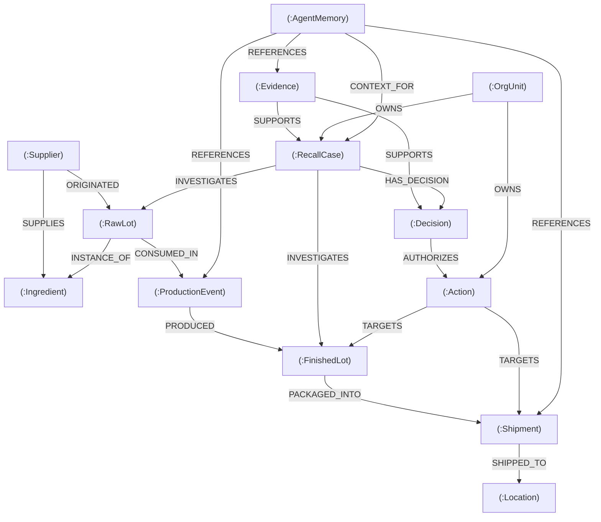

# RECALLMESH: FalkorDB Property-Graph Schema Specification

> **Notice:** The Cypher query patterns described in this document represent conceptual design specifications for planning and schema validation. **The query syntax has not yet been executed or validated against a live FalkorDB instance.** All operations must be formally tested in subsequent development phases.

---

## 1. Schema Design Principles & Free Tier Efficiency

To operate reliably within the **FalkorDB Cloud Free tier** without assuming unverified memory limits, the RECALLMESH schema adheres to strict property-graph optimization rules:
1. **Lean Primitive Attributes:** Use short strings, integers, ISO-8601 timestamps, and compact enum values for node and edge properties.
2. **Externalized Payloads:** Never store binary blobs (PDFs, raw lab scans, images) directly inside graph properties. Instead, store lightweight resource URIs, document titles, and cryptographic SHA-256 hashes inside `Evidence` nodes.
3. **Directed Semantic Edges:** Model physical transitions (e.g., `CONSUMED_IN`, `PRODUCED`, `SHIPPED_TO`) and conceptual links (`SUPPORTS`, `AUTHORIZES`, `CONTEXT_FOR`) using distinct, low-overhead edge types.
4. **GS1 EPCIS 2.0 & FSMA Rule 204 Alignment:** Align entity semantics directly with **Critical Tracking Events (CTEs)** (Transformation, Shipping, Receiving) and **Key Data Elements (KDEs)** (Traceability Lot Codes, Global Location Numbers).
5. **Reproducible Synthetic Seed Data Requirement:** The entire demo graph topology must be generated from deterministic, version-controlled synthetic seed data fixtures (e.g., JSON/Python scripts), allowing clean graph teardown, recreation, and benchmark verification without accumulating stale state.

---

## 2. Entity Model (Node Labels)



### 2.1 Physical Supply Chain Nodes

#### `(:Supplier)`
* Represents an upstream ingredient vendor, farming cooperative, or raw materials distributor.
* **Properties:**
  * `supplier_id` *(String, Primary Key)* – e.g., `"SUP-APEX-01"`
  * `name` *(String)* – e.g., `"Apex Spice Co."`
  * `gln` *(String)* – Global Location Number (GS1 standard)
  * `risk_rating` *(String)* – `"LOW" | "ELEVATED" | "CRITICAL"`
  * `active` *(Boolean)*

#### `(:Ingredient)`
* Represents a standardized raw material specification.
* **Properties:**
  * `ingredient_id` *(String, PK)* – e.g., `"ING-CUMIN-ORG"`
  * `common_name` *(String)* – e.g., `"Organic Ground Cumin"`
  * `allergen_flags` *(List of Strings)* – e.g., `["NONE"]`
  * `ftl_category` *(String)* – FDA Food Traceability List category (or `"NON_FTL"`)

#### `(:RawLot)`
* Represents a discrete batch of raw materials received from a supplier (FSMA Receiving CTE).
* **Properties:**
  * `lot_code` *(String, PK)* – Traceability Lot Code (TLC), e.g., `"LOT-CUM-2026-088"`
  * `received_at` *(String, ISO-8601)* – e.g., `"2026-09-12T08:30:00Z"`
  * `quantity_kg` *(Float)* – e.g., `500.0`
  * `disposition` *(String)* – Physical/operational status: `"AVAILABLE" | "IN_USE" | "QUARANTINED" | "REJECTED" | "DESTROYED"`
  * `traceability_status` *(String)* – Epistemic provenance: `"VERIFIED" | "PROVISIONAL" | "UNKNOWN" | "GAP_DETECTED" | "CONTRADICTED"`

#### `(:ProductionEvent)`
* Represents a transformation CTE where raw materials are blended, cooked, or processed into finished goods.
* **Properties:**
  * `event_id` *(String, PK)* – e.g., `"PROD-EVT-4401"`
  * `facility_id` *(String)* – Processing plant code
  * `line_id` *(String)* – Packaging/mixing line identifier, e.g., `"LINE-02"`
  * `started_at` *(String, ISO-8601)*
  * `completed_at` *(String, ISO-8601)*
  * `operator_id` *(String)* – Supervisor employee code

#### `(:FinishedLot)`
* Represents a packaged, finished commercial product batch (Transformation output).
* **Properties:**
  * `lot_code` *(String, PK)* – e.g., `"FL-SALSA-101"`
  * `product_name` *(String)* – e.g., `"Artisan Roasted Salsa 16oz"`
  * `sku` *(String)* – e.g., `"SKU-SAL-16OZ"`
  * `units_produced` *(Integer)* – e.g., `2400`
  * `best_by_date` *(String, Date)* – e.g., `"2027-03-15"`
  * `disposition` *(String)* – Physical/operational status: `"AVAILABLE" | "SHIPPED" | "QUARANTINED" | "RECALLED" | "DESTROYED"`
  * `traceability_status` *(String)* – Epistemic provenance: `"VERIFIED" | "PROVISIONAL" | "UNKNOWN" | "GAP_DETECTED" | "CONTRADICTED"`

#### `(:Shipment)`
* Represents a shipping CTE transferring physical custody of finished lots to an external facility.
* **Properties:**
  * `shipment_id` *(String, PK)* – Bill of Lading (BOL) or tracking ID, e.g., `"SHIP-8821"`
  * `carrier_name` *(String)* – e.g., `"Swift Cold Logistics"`
  * `dispatched_at` *(String, ISO-8601)*
  * `units_shipped` *(Integer)*
  * `shipping_disposition` *(String)* – Operational transit status: `"IN_TRANSIT" | "DELIVERED" | "STOPPED" | "RETURNED"`
  * `traceability_status` *(String)* – Epistemic provenance: `"VERIFIED" | "UNKNOWN" | "GAP_DETECTED"`

#### `(:Location)`
* Represents a customer distribution center, retail store, or regional warehouse.
* **Properties:**
  * `location_id` *(String, PK)* – e.g., `"LOC-RETAIL-ALPHA"`
  * `name` *(String)* – e.g., `"Pacific Regional Distribution Center"`
  * `gln` *(String)* – GS1 Global Location Number
  * `contact_email` *(String)*
  * `state_code` *(String)* – e.g., `"CA"`

---

### 2.2 Governance, Evidence & Agent Reasoning Nodes

#### `(:RecallCase)`
* Represents an active or historical recall investigation.
* **Properties:**
  * `case_id` *(String, PK)* – e.g., `"CASE-2026-004"`
  * `opened_at` *(String, ISO-8601)*
  * `hazard_type` *(String)* – `"BIOLOGICAL" | "CHEMICAL" | "PHYSICAL" | "ALLERGEN"`
  * `pathogen_or_hazard` *(String)* – e.g., `"Salmonella enterica"`
  * `provisional_class` *(String)* – `"CLASS_I" | "CLASS_II" | "CLASS_III" | "UNDETERMINED"`
  * `lifecycle_status` *(String)* – `"OPEN" | "INVESTIGATING" | "CONTAINED" | "CLOSED"`

#### `(:Evidence)`
* Represents an immutable piece of grounding data supporting the investigation.
* **Properties:**
  * `evidence_id` *(String, PK)* – e.g., `"EVID-LAB-904"`
  * `evidence_type` *(String)* – `"SUPPLIER_ALERT" | "COA_LAB_REPORT" | "BOL" | "CUSTOMER_COMPLAINT"`
  * `source_uri` *(String)* – URI to external secure store
  * `hash_sha256` *(String)* – Cryptographic integrity digest
  * `recorded_at` *(String, ISO-8601)*
  * `confidence_score` *(Float)* – `0.0` to `1.0`

#### `(:Decision)`
* Represents an explicit human or policy evaluation milestone.
* **Properties:**
  * `decision_id` *(String, PK)* – e.g., `"DEC-2026-012"`
  * `decision_type` *(String)* – `"INITIATE_QUARANTINE" | "CLEAR_CONTROL_LOT" | "ESCALATE_TO_LEGAL"`
  * `authorized_by` *(String)* – User identifier (e.g., `"qa.director@company.com"`)
  * `timestamp` *(String, ISO-8601)*
  * `rationale` *(String)*

#### `(:Action)`
* Represents an operational execution task formulated by the agent and executed upon approval.
* **Properties:**
  * `action_id` *(String, PK)* – e.g., `"ACT-QUARANTINE-01"`
  * `action_type` *(String)* – `"INTERNAL_HOLD" | "CONSIGNEE_STOP_SHIP" | "SUPPLIER_AUDIT"`
  * `status` *(String)* – `"PROPOSED" | "APPROVED" | "EXECUTED" | "REJECTED"`
  * `target_entity_id` *(String)* – Target lot or shipment ID
  * `generated_at` *(String, ISO-8601)*

#### `(:OrgUnit)`
* Represents organizational ownership and responsibilities (Company Brain).
* **Properties:**
  * `unit_id` *(String, PK)* – e.g., `"ORG-QA"`, `"ORG-LEGAL"`, `"ORG-LOGISTICS"`
  * `lead_contact` *(String)*
  * `escalation_level` *(Integer)*

#### `(:AgentMemory)`
* Represents persistent episodic memory, intermediate hypotheses, and cross-session context for agents.
* **Properties:**
  * `memory_id` *(String, PK)* – e.g., `"MEM-SESS-881"`
  * `agent_role` *(String)* – `"INVESTIGATOR" | "COORDINATOR" | "AUDITOR"`
  * `session_id` *(String)*
  * `summary` *(String)* – Condensed summary of working state
  * `created_at` *(String, ISO-8601)*

---

## 3. Relationships & Cardinality

| Relationship | Source Node | Target Node | Semantics / Cardinality |
| :--- | :--- | :--- | :--- |
| `[:SUPPLIES]` | `Supplier` | `Ingredient` | $1 \dots N$ (A supplier supplies many ingredients) |
| `[:ORIGINATED]` | `Supplier` | `RawLot` | $1 \dots N$ (Traceability origin) |
| `[:INSTANCE_OF]` | `RawLot` | `Ingredient` | $N \dots 1$ (Material catalog typing) |
| `[:CONSUMED_IN]` | `RawLot` | `ProductionEvent` | $M \dots N$ (Batch transformation inputs) |
| `[:PRODUCED]` | `ProductionEvent` | `FinishedLot` | $1 \dots N$ (Batch transformation outputs) |
| `[:PACKAGED_INTO]` | `FinishedLot` | `Shipment` | $M \dots N$ (Palletizing & logistics) |
| `[:SHIPPED_TO]` | `Shipment` | `Location` | $N \dots 1$ (Destination custody transfer) |
| `[:INVESTIGATES]` | `RecallCase` | `RawLot` / `FinishedLot` | $M \dots N$ (Scope of case inquiry) |
| `[:SUPPORTS]` | `Evidence` | `RecallCase` / `Decision` | $M \dots N$ (Grounded audit provenance) |
| `[:HAS_DECISION]` | `RecallCase` | `Decision` | $1 \dots N$ (Chronological audit history) |
| `[:AUTHORIZES]` | `Decision` | `Action` | $1 \dots N$ (Governance gate) |
| `[:TARGETS]` | `Action` | `FinishedLot` / `Shipment` | $1 \dots N$ (Operational containment) |
| `[:OWNS]` | `OrgUnit` | `RecallCase` / `Action` | $1 \dots N$ (Accountability & escalation) |
| `[:CONTEXT_FOR]` | `AgentMemory` | `RecallCase` | $N \dots 1$ (Episodic context persistence) |
| `[:REFERENCES]` | `AgentMemory` | `ProductionEvent` / `Evidence` | $M \dots N$ (Working memory pointers) |

---

## 4. Traceability Status vs. Operational Disposition

To prevent binary assumptions and conflation of epistemic knowledge with physical supply chain reality, RECALLMESH strictly decouples **traceability status** from **operational lot disposition**. These are orthogonal dimensions: a lot may possess completely verified provenance while simultaneously being placed under an emergency quarantine hold.

### 4.1 Traceability Status (Epistemic Chain-of-Custody Dimension)
Reflects the completeness, continuity, and evidentiary verification of the graph lineage:
1. `VERIFIED`: Complete, unbroken custody chain from supplier receiving through transformation CTEs to shipping KDEs, supported by cryptographic document evidence.
2. `PROVISIONAL`: Initial lineage records exist but await laboratory confirmation (COA assay) or counterparty document ingestion.
3. `UNKNOWN`: Insufficient evidence or uninspected subgraph; the system explicitly avoids declaring safety in the absence of evidence.
4. `GAP_DETECTED`: Discontinuity explicitly identified in the path (e.g., an orphaned Finished Lot with no recorded input Raw Lots, or a Shipment lacking a destination GLN). Triggers an automated QA audit review task.
5. `CONTRADICTED`: Conflicting timestamps, overlapping lot allocations, or physically impossible sequences (e.g., product dispatched before production transformation commenced).

### 4.2 Operational Disposition (Physical / Logistics State Dimension)
Reflects the physical location, commercial availability, and regulatory hold status:
1. `AVAILABLE`: Released for manufacturing use or commercial distribution.
2. `IN_USE`: Currently staged or actively being consumed in an open production run.
3. `IN_TRANSIT`: Dispatched on a carrier vehicle; physical custody with logistics partner.
4. `DELIVERED`: Received at customer destination or regional distribution center.
5. `QUARANTINED`: Physical movement, blending, or sale is strictly blocked pending safety/regulatory review.
6. `RECALLED`: Formal commercial recall action initiated; product subject to retrieval or customer return.
7. `DESTROYED`: Product officially denatured, discarded, or incinerated under verified audit supervision.

---

## 5. Four Required Core Query Operations (Cypher Design)

> **Important:** The queries below demonstrate the required graph patterns. They are design specifications and must be tested against live data in later phases.

### 5.1 Downstream Tracing (Forward Blast Radius)
* **Goal:** Given a compromised raw ingredient lot (`$raw_lot_code`), identify all impacted finished lots, shipments, and customer locations.
* **Cypher Pattern:**
  ```cypher
  MATCH (r:RawLot {lot_code: $raw_lot_code})-[:CONSUMED_IN]->(p:ProductionEvent)-[:PRODUCED]->(f:FinishedLot)
  OPTIONAL MATCH (f)-[:PACKAGED_INTO]->(s:Shipment)-[:SHIPPED_TO]->(loc:Location)
  RETURN r.lot_code AS suspect_raw_lot,
         p.event_id AS production_event,
         f.lot_code AS affected_finished_lot,
         f.disposition AS finished_lot_status,
         s.shipment_id AS shipment_id,
         loc.name AS consignee_location,
         loc.contact_email AS consignee_contact;
  ```

### 5.2 Upstream Tracing (Root-Cause Lineage)
* **Goal:** Given an adulterated finished lot (`$finished_lot_code`), traverse backward through production to isolate raw ingredient lots, suppliers, and sibling finished lots that shared the same inputs.
* **Cypher Pattern:**
  ```cypher
  MATCH (target:FinishedLot {lot_code: $finished_lot_code})<-[:PRODUCED]-(p:ProductionEvent)<-[:CONSUMED_IN]-(r:RawLot)<-[:ORIGINATED]-(sup:Supplier)
  MATCH (r)-[:CONSUMED_IN]->(other_p:ProductionEvent)-[:PRODUCED]->(sibling:FinishedLot)
  WHERE sibling.lot_code <> target.lot_code
  RETURN target.lot_code AS recalled_lot,
         p.event_id AS production_event,
         r.lot_code AS consumed_ingredient_lot,
         sup.name AS supplier_name,
         collect(DISTINCT sibling.lot_code) AS cross_contaminated_sibling_lots;
  ```

### 5.3 Traceability-Gap Detection
* **Goal:** Detect finished lots that exist in inventory or transit but have missing or incomplete transformation records, exposing severe regulatory liability under FSMA Rule 204.
* **Cypher Pattern:**
  ```cypher
  MATCH (f:FinishedLot)
  WHERE NOT (f)<-[:PRODUCED]-(:ProductionEvent)
     OR NOT (f)<-[:PRODUCED]-(:ProductionEvent)<-[:CONSUMED_IN]-(:RawLot)
  SET f.traceability_status = 'GAP_DETECTED'
  RETURN f.lot_code AS orphaned_finished_lot,
         f.disposition AS current_disposition,
         'MISSING_TRANSFORMATION_LINK' AS defect_type;
  ```

### 5.4 Action-Plan Construction (Targeted Containment)
* **Goal:** Given an authorized decision (`$decision_id`), compile all unquarantined finished lots and in-transit shipments into structured action records for dispatch.
* **Cypher Pattern:**
  ```cypher
  MATCH (d:Decision {decision_id: $decision_id})<-[:HAS_DECISION]-(c:RecallCase)-[:INVESTIGATES]->(target)
  WHERE target:FinishedLot
  MATCH (target)-[:PACKAGED_INTO]->(s:Shipment)-[:SHIPPED_TO]->(loc:Location)
  WHERE s.shipping_status <> 'STOPPED'
  RETURN target.lot_code AS target_lot,
         s.shipment_id AS target_shipment,
         s.carrier_name AS carrier,
         loc.name AS destination,
         loc.contact_email AS destination_email,
         'CONSIGNEE_HOLD_NOTICE' AS proposed_action;
  ```

---

## 6. Why Removing FalkorDB Breaks the Core Workflow

1. **Failure of Relational SQL (`WITH RECURSIVE` Explosion):**
   * Multi-tier food supply networks are neither static trees nor clean hierarchies. They feature $M \times N$ splits, multi-ingredient batchings, and variable-depth supply chains.
   * In PostgreSQL or MySQL, tracing an unknown depth of raw material -> transformation -> re-blend -> packaging -> multi-drop shipment requires deep recursive common table expressions (CTEs). Under production loads, recursive SQL queries encounter exponential join state expansions, slow execution times, and complex failure modes on cyclic or rework loops.
   * FalkorDB implements native property-graph algorithms powered by the **GraphBLAS** linear algebra engine, executing matrix-based graph traversals in milliseconds.
2. **Failure of Pure Vector RAG:**
   * Vector search operates over semantic similarity of text embeddings. It has no concept of topological reachability, directional custody, or unbroken links.
   * A vector search for "Salmonella spice recall" will retrieve documents discussing similar spices, but **cannot mathematically guarantee whether Pallet #402 contains Lot #088**. Only a deterministic graph traversal can prove custody.
3. **Loss of Agent Memory & Company Brain Co-location:**
   * In conventional architectures, agent memory lives in separate key-value caches (Redis) while company policies live in document stores.
   * FalkorDB allows unifying **physical reality** (lots, shipments), **agent cognitive state** (memory, hypotheses), and **enterprise governance** (SOPs, decisions) inside a single traversable graph. Removing FalkorDB shatters this unified context model.

---

## 7. Primary and Academic References

1. **Jing, R., & Li, P. (2024).**  
   *Knowledge graph for integration and quality traceability of agricultural product information.*  
   *Frontiers in Sustainable Food Systems*, 8, 1389945.  
   DOI: [10.3389/fsufs.2024.1389945](https://www.frontiersin.org/articles/10.3389/fsufs.2024.1389945/full)
2. **Panayotov, A., Lambov, I., et al. (2025).**  
   *A Governance-Aware, Privacy-Preserving, Event-Driven Conceptual Model for Supply Chain Traceability.*  
   *Applied Sciences / Information*, MDPI.  
   DOI: [10.3390/app15010115](https://doi.org/10.3390/app15010115)
3. **Chen, R.-Y. (2015).**  
   *Autonomous tracing systems for backward design in food supply chains.*  
   *Food Control*, 51, 70–84.  
   DOI: [10.1016/j.foodcont.2014.11.004](https://doi.org/10.1016/j.foodcont.2014.11.004)
4. **GS1 Global. (2022/2025).**  
   *Electronic Product Code Information Services (EPCIS) and Core Business Vocabulary (CBV) Standard Release 2.0.*  
   URL: [https://www.gs1.org/standards/epcis](https://www.gs1.org/standards/epcis)
5. **U.S. Food and Drug Administration (FDA). (2022/2026).**  
   *FSMA Final Rule on Requirements for Additional Traceability Records for Certain Foods.*  
   21 CFR Part 1, Subpart S.  
   URL: [https://www.fda.gov/food/food-safety-modernization-act-fsma/fsma-final-rule-food-traceability](https://www.fda.gov/food/food-safety-modernization-act-fsma/fsma-final-rule-food-traceability)
