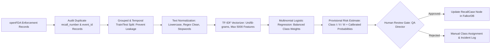

# RECALLMESH: Offline Research Model Training Plan (Recall Severity Estimation)

> **Important Constraints & Compliance Notice:**  
> 1. **Offline Research Model Only:** The model proposed herein is strictly an **offline, exploratory research classifier** developed to evaluate whether classical NLP can provide helpful triage signals for human reviewers. It is **not** an authoritative, production-grade automated decision engine.  
> 2. **Zero Autonomous Authorization:** Model outputs provide **provisional, non-authoritative risk estimates only**. Under no circumstances does a model prediction authorize, trigger, or execute a recall or quarantine action without affirmative human review and sign-off by a qualified food safety authority.  
> 3. **openFDA Regulatory Disclaimer:** The openFDA API and dataset are public research resources. Per FDA policy, openFDA data is **not** to be used to broadcast real-time public alerts, verify live recall lifecycle statuses, or substitute for formal communication with FDA District Recall Coordinators ([openFDA Disclaimer](https://open.fda.gov/about/disclaimer/)).  
> 4. **No Fabricated Benchmarks:** This document does not invent dataset sample counts, test split accuracies, or precision/recall figures. All baseline metrics must be computed strictly during the actual model training execution phase.

---

## 1. Dataset Evaluation: openFDA Food Enforcement Data

### 1.1 Dataset Source & Schema
The public **openFDA Food Enforcement API** (`https://api.fda.gov/food/enforcement.json`) archives historical recall enforcement reports published by the U.S. FDA. Each record corresponds to an administrative entry within an enforcement action and contains structured administrative fields, geographical distribution data, and free-text narrative descriptions.

* **Primary Endpoint:** `https://api.fda.gov/food/enforcement.json`
* **Official Documentation:** [https://open.fda.gov/apis/food/enforcement/](https://open.fda.gov/apis/food/enforcement/)

### 1.2 Target Classification Labels
The FDA defines three regulatory risk classes under 21 CFR Part 7:
* **Class I:** A situation in which there is a reasonable probability that the use of, or exposure to, a violative product will cause **serious adverse health consequences or death** (e.g., *Listeria monocytogenes*, *Salmonella*, undeclared peanut protein in children's food).
* **Class II:** A situation in which use of or exposure may cause **temporary or medically reversible adverse health consequences**, or where the probability of serious adverse health consequences is remote (e.g., undeclared wheat/gluten, non-lethal foreign plastic fragments).
* **Class III:** A situation in which use of or exposure is **not likely to cause adverse health consequences** (e.g., minor labeling defects, slight off-taste without contamination, packaging aesthetic issues).

### 1.3 Feature Selection (Text Narratives)
To predict the provisional risk class, we extract and concatenate the primary narrative fields:
* `reason_for_recall` *(Primary Feature)*: Description of the hazard identified (e.g., *"Product may be contaminated with Clostridium botulinum spores"*).
* `product_description` *(Secondary Feature)*: Description of the commercial food item (e.g., *"Canned organic black beans 15oz"*).
* `code_info` *(Filtering/Context)*: Lot codes, sell-by dates, UPC barcodes.

---

## 2. Model Architecture: CPU-Friendly TF-IDF + Logistic Regression

Given the local development environment constraints (CPU execution on Intel UHD Graphics, no dedicated CUDA GPU), heavy deep-learning transformers are unnecessary and inefficient for this tabular/text triage task. We propose a transparent, highly interpretable classical NLP pipeline using `scikit-learn` in **Python 3.11**.

### 2.1 Preprocessing & Data-Leakage Prevention
1. **Inspection of Duplicate `recall_number` and `event_id` Records:**
   * In openFDA enforcement data, multiple rows frequently share the same underlying `recall_number` or overarching `event_id`. 
   * **Do not blindly drop duplicates:** Records with identical recall numbers often represent distinct product SKUs, varied package sizes, or differing distribution regions that provide valuable lexical context.
   * **Mandatory Inspection Protocol:** Before deduplication or training, inspect the variance in `product_description` and `reason_for_recall` across identical `recall_number` entries. If text is identical, deduplicate to a single canonical record. If text differs, retain distinct SKU descriptions or aggregate them per event.
2. **Strict Prevention of Train/Test Leakage:**
   * Naive row-level random splitting causes severe data leakage because different SKUs from the same underlying contamination event (sharing the exact same `reason_for_recall`) would appear in both training and test sets, falsely inflating evaluation scores.
   * **Grouped Temporal Splitting:** Split data chronologically by `recall_initiation_date`, and ensure all records associated with a given `event_id` or `recall_number` are grouped atomically into *either* the training partition *or* the test partition, never split across both.
3. **Text Normalization:**
   * Concatenate `product_description` and `reason_for_recall`.
   * Lowercase text and strip non-alphanumeric noise using regex patterns.
   * Strip standard English stopwords while preserving safety-critical negation tokens (e.g., *"not"*, *"free"* in allergen contexts like *"gluten-free"*).
4. **Vectorization:**
   * `TfidfVectorizer(ngram_range=(1, 2), max_features=5000, sublinear_tf=True, min_df=3)`
   * Extracting unigrams and bigrams captures multi-word hazard phrases (e.g., *"listeria monocytogenes"*, *"undeclared egg"*, *"peanut butter"*).

### 2.2 Classifier Specification
* **Algorithm:** `LogisticRegression(multi_class='multinomial', solver='lbfgs', class_weight='balanced', max_iter=1000, random_state=42)`
* **Rationale:**
  * **Interpretable Coefficients:** Direct inspection of the top positive and negative log-odds weights for each class provides complete explainability (e.g., inspecting which terms drive a Class I prediction).
  * **Calibrated Probabilities:** Produces well-calibrated soft probabilities across classes, allowing the agent to express uncertainty when the top probability is low (e.g., $<0.65$).
  * **Zero GPU Requirement:** Trains in seconds on any standard multi-core CPU.

---

## 3. Data-Quality & Class-Balance Checks

1. **Null/Missing Value Audit:** Exclude records missing either `reason_for_recall` or a valid `classification` label (`"Class I"`, `"Class II"`, `"Class III"`).
2. **Class Imbalance Handling:**
   * In historical FDA enforcement data, **Class II** recalls typically constitute the numerical majority, while **Class III** recalls are less frequent.
   * Setting `class_weight='balanced'` in the Logistic Regression objective penalizes errors on the minority classes inversely proportional to class frequencies, ensuring Class I hazards are not overlooked.
3. **Temporal Evaluation Split (Held-Out Test Set):**
   * Avoid random k-fold cross-validation, which causes temporal data leakage.
   * Sort records chronologically by `recall_initiation_date` or `report_date`.
   * Use earlier historical records (e.g., historical baseline years) for training and validation, and reserve the most recent time slice as a strictly held-out test set to evaluate model generalizability on emerging hazard descriptions.

---

## 4. Evaluation Metrics & Reporting Protocol

The evaluation protocol enforces three primary metrics:

1. **Per-Class Recall (Sensitivity):**
   $$\text{Recall}_{\text{Class } i} = \frac{TP_i}{TP_i + FN_i}$$
   * **Safety Priority:** $\text{Recall}_{\text{Class I}}$ must be prioritized. A false negative on a Class I recall (misclassifying a lethal hazard as Class II or III) is an intolerable safety failure.
2. **Macro-Averaged F1-Score:**
   $$\text{Macro } F_1 = \frac{1}{3} \sum_{i \in \{\text{I}, \text{II}, \text{III}\}} F_{1, i}$$
   * Treats all three classes equally, penalizing models that simply collapse to the majority class.
3. **Normalized Confusion Matrix:**
   * A $3 \times 3$ contingency table showing the proportion of actual vs. predicted classifications to identify specific confusion modes (e.g., Class I vs. Class II boundary errors).

*(Note: Real quantitative metrics will be reported when running the training pipeline against the ingested dataset. No numbers are fabricated here.)*

---

## 5. Dataset Limitations & Safety Guardrails

### 5.1 Dataset Limitations
* **Lag in Historical Data:** openFDA data represents officially categorized historical enforcement actions that were investigated and classified post-incident. It does not reflect active, real-time factory floor emergencies.
* **Lexical Drift:** Terminology evolves over time (e.g., new allergen regulations like sesame under the FASTER Act of 2021). Models trained on older data may initially under-weight newly regulated allergens.
* **Jurisdictional Boundary:** openFDA covers FDA-regulated items. USDA FSIS-regulated items (meat, poultry, egg products) follow distinct reporting frameworks.

### 5.2 Strict Operational Guardrails
* **Advisory Only:** The agent records the predicted class in the graph as `provisional_class`, flagged with `review_required = true`.
* **Action Block:** The containment workflow blocks any automated external notification dispatch until the QA Director explicitly reviews the evidence and signs off on the classification.

---

## 6. Primary and Academic References

1. **Alqahtani, A., et al. (2025/2026).**  
   *Explainable machine learning framework for foodborne disease outbreak prediction and risk classification.*  
   *Frontiers in Public Health*, 12, 1485600.  
   DOI: [10.3389/fpubh.2024.1485600](https://doi.org/10.3389/fpubh.2024.1485600)
2. **openFDA. (2026).**  
   *openFDA API Documentation: Food Enforcement Reports.*  
   URL: [https://open.fda.gov/apis/food/enforcement/](https://open.fda.gov/apis/food/enforcement/)
3. **openFDA. (2026).**  
   *openFDA Service Disclaimer and Terms of Use.*  
   URL: [https://open.fda.gov/about/disclaimer/](https://open.fda.gov/about/disclaimer/)
4. **U.S. Food and Drug Administration (FDA). (2024).**  
   *FDA Regulatory Procedures Manual, Chapter 7: Recall Procedures.*  
   URL: [https://www.fda.gov/inspections-compliance-enforcement-and-criminal-investigations/compliance-manuals/regulatory-procedures-manual](https://www.fda.gov/inspections-compliance-enforcement-and-criminal-investigations/compliance-manuals/regulatory-procedures-manual)
