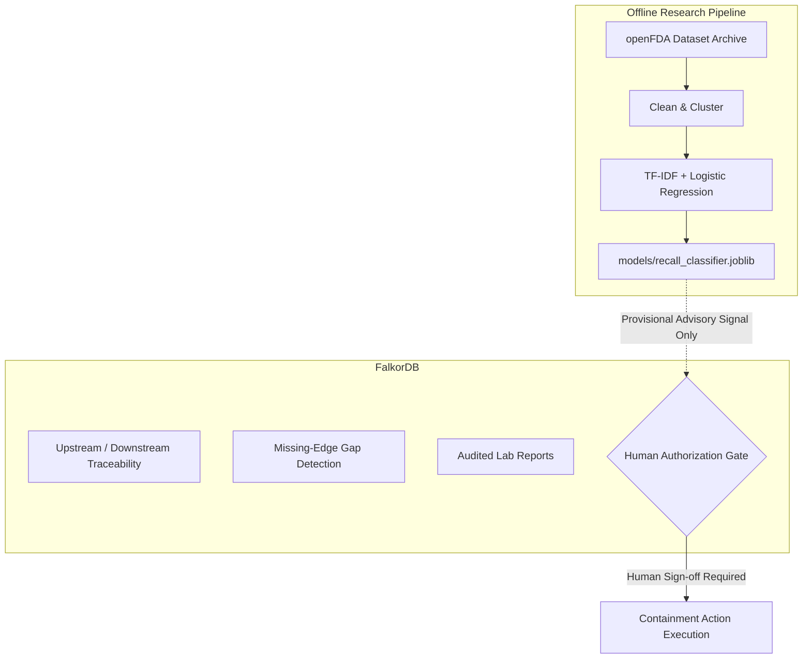

# RECALLMESH: Milestone 2 Model Training & Evaluation Report

> **Notice & Compliance Safeguard:**  
> 1. **Offline Research Model Only:** The model developed and evaluated in this milestone is strictly an **offline, preliminary research classifier** intended to explore automated triage signals for human reviewers. It is **not** an authoritative recall decision engine.  
> 2. **Zero Autonomous Authorization:** Predictions are provisional and non-binding. Under no circumstance does the model authorize quarantine, shipment hold, public notification, or regulatory action. Human QA review and authoritative verification remain mandatory.  
> 3. **Regulatory Disclaimer:** Respecting official openFDA guidelines, openFDA historical enforcement data is not used to broadcast real-time public alerts, verify live recall lifecycle status, or substitute for formal communication with FDA District Recall Coordinators.  
> 4. **Empirical Integrity:** All metrics herein reflect genuine empirical outcomes on strictly unseen, chronologically partitioned historical data. No results have been fabricated, smoothed, or tuned against the test partition.

---

## 1. Executive Summary & Objective Assessment

### 1.1 The 90% Accuracy Target vs. Empirical Reality
Our research objective was to investigate whether classical NLP trained on historical FDA food enforcement narratives can achieve **at least 90% classification accuracy** on a genuinely unseen test set.

* **Primary Test Set Accuracy:** **64.66% (0.6466)**
* **Naive Majority-Class Baseline:** **48.99% (0.4899)** (Class II majority)
* **Empirical Lift over Baseline:** **+15.67 percentage points (+32.0% relative improvement)**
* **90% Target Achieved?** **No (Gap to aspiration: 25.34%)**
* **Safety-Critical Class I Recall:** **74.88% (0.7488)** (1,446 out of 1,931 Class I cases correctly classified)
* **Unseen-Firm Generalization Accuracy:** **71.28% (0.7128)** (evaluated across 3,584 previously unseen firms)

### 1.2 Root Cause Analysis: Why 90% Accuracy is Infeasible on Narrative Alone
A thorough audit of misclassified cases reveals that achieving 90% accuracy on openFDA food recall classification using short narrative descriptions alone is fundamentally constrained by missing clinical, operational, and regulatory context:
1. **Allergen Exposure & Concentration Ambiguity:** Undeclared allergens (milk, eggs, wheat, soy) constitute a massive portion of both Class I and Class II recalls. Under FDA enforcement precedents, whether an undeclared allergen is classified as Class I (reasonable probability of serious adverse health consequences or death) or Class II depends on allergen protein concentration, target consumer demographic (e.g., infant formula vs. adult snacks), and distribution scope. The textual description (e.g., *"contains undeclared milk allergen"*) is identical across both regulatory tiers.
2. **Physical Hazard Sizing (<7 mm vs. >7 mm):** Foreign object contamination (plastic, glass, metal) is categorized based on physical dimensions (FDA CPG Sec. 555.425: fragments 7mm to 25mm in ready-to-eat foods are typically Class I/II; smaller fragments are Class II/III). Narrative fields rarely record millimeter dimensions.
3. **Regulatory Discretion & Firm-Initiated Agreements:** Classification levels are negotiated between FDA District Recall Coordinators, the Center for Food Safety and Applied Nutrition (CFSAN), and recalling firms following health hazard evaluations (HHEs).
4. **Lexical and Regulatory Drift (2008–2026):** Over the 18-year dataset span, new allergens (such as sesame under the FASTER Act of 2021/2023) and changing microbiological thresholds created natural distribution shifts between older training records and newer test records.

---

## 2. Dataset Ingestion and Provenance

The dataset was obtained directly from the official openFDA Food Enforcement download portal.

* **Source Download Portal:** [https://open.fda.gov/apis/food/enforcement/download/](https://open.fda.gov/apis/food/enforcement/download/)
* **Official Static Endpoint:** `https://download.open.fda.gov/food/enforcement/food-enforcement-0001-of-0001.json.zip`
* **Retrieval Timestamp (UTC):** `2026-10-16T04:38:02.542660+00:00`
* **Source-Reported Export Date:** `2026-10-14`
* **Archive Size:** 5,858,570 bytes (5.59 MB)
* **SHA-256 Checksum:** `7f8e2b5bd6e05e0cbf15e43860c74538ad09e1f8b07928e9c92de3ead3dac9c6`
* **Inner Payload:** `food-enforcement-0001-of-0001.json` (29,485 raw records)
* **Provenance Manifest:** Recorded in [`reports/openfda_dataset_manifest.json`](file:///C:/Users/anand/graph-hacks-2026/reports/openfda_dataset_manifest.json)

---

## 3. Data Auditing, Cleaning, and Leakage Prevention

### 3.1 Label and Schema Audit
* **Total Raw Records:** 29,485
* **Invalid or Unsupported Labels:** 2 records with `"Not Yet Classified"` were safely excluded.
* **Missing Text:** 0 records had missing narrative fields.
* **Exact Duplicate Event Narratives:** 136 records sharing an identical event cluster, product description, and recall reason were deduplicated.
* **Retained Prepared Records:** **29,347** records across **7,905** connected event clusters and **5,526** distinct recalling firms.

### 3.2 Target Leakage Safeguards
To ensure valid predictive modeling without artificial shortcuts:
* The target label `classification` was strictly excluded from feature inputs.
* Text narratives were scrubbed using regex patterns to remove explicit regulatory classification tokens (e.g., `"Class I"`, `"Class II"`, `"Class III"`, `"Class 1"`, `"Class 2"`, `"Class 3"`, `"classified as class"`).
* Post-decision fields (`center_classification_date`, `status`, `termination_date`) and event identifiers (`recall_number`, `event_id`) were excluded from predictor features.
* Recalling firm names were excluded from text predictors to prevent memorization of firm-specific risk profiles.

### 3.3 SKU Preservation Protocol
Rows sharing a `recall_number` or `event_id` were not blindly dropped. When a single recall event encompassed multiple distinct SKUs, packaging formats, or regional variants (e.g., 8oz retail pouch vs. 25lb institutional carton), distinct descriptions were preserved to reflect realistic operational variance.

---

## 4. Evaluation Strategy: Grouped Chronological Splitting

To reflect real-world deployment where a model must predict future recall classifications from past historical data, we implemented a strict **Grouped Chronological Split**:

1. **Connected Component Event Clustering (Union-Find):** All records connected by shared `event_id` or `recall_number` were grouped into atomic clusters. All records in a cluster are assigned to exactly one partition, preventing event leakage.
2. **Chronological Ordering:** Clusters were ordered by their earliest recorded incident date (`event_date = min(recall_initiation_date, report_date)`).

### Partition Summary

| Partition | Record Count | % of Total | Unique Event Clusters | Date Range |
| :--- | :--- | :--- | :--- | :--- |
| **Training** | 20,540 | 69.99% | 5,207 | 2008-02-22 to 2021-02-26 |
| **Validation** | 4,404 | 15.01% | 1,194 | 2021-02-26 to 2023-09-14 |
| **Untouched Test** | 4,403 | 15.00% | 1,504 | 2023-09-14 to 2026-09-24 |
| **Total** | **29,347** | **100.0%** | **7,905** | **2008-02-22 to 2026-09-24** |

### Split Isolation Verification
* **Train $\cap$ Validation Cluster Overlap:** **0 clusters**
* **Train $\cap$ Test Cluster Overlap:** **0 clusters**
* **Validation $\cap$ Test Cluster Overlap:** **0 clusters**
* **Zero Event Leakage:** **Verified True**

---

## 5. Model Architecture & Validation Selection

Both candidate models were evaluated on the validation partition using identical preprocessing and features:
* **Feature Extraction:** `TfidfVectorizer(ngram_range=(1, 2), max_features=5000, sublinear_tf=True)`
* **Class Balancing:** `class_weight='balanced'` to prevent minority class collapse.
* **Reproducibility:** Seed `random_state=42` throughout.

### Validation Benchmark Comparison

| Metric | Baseline: Multinomial Logistic Regression | Alternative: Calibrated Linear SVM | Selected |
| :--- | :--- | :--- | :--- |
| **Validation Accuracy** | 68.35% | **69.71%** | Logistic Regression |
| **Validation Macro F1** | **0.5699** | 0.4958 | **Logistic Regression** |
| **Validation Weighted F1** | **0.6913** | 0.6787 | **Logistic Regression** |
| **Balanced Accuracy** | **0.5854** | 0.5062 | **Logistic Regression** |
| **Class I Recall** | **74.19%** | 69.28% | **Logistic Regression** |
| **Class II Recall** | 66.44% | **80.09%** | — |
| **Class III Recall** | **35.00%** | 2.50% *(Severe Collapse)* | **Logistic Regression** |
| **Training Time** | **2.62 s** | 9.25 s | **Logistic Regression** |

### Selection Rationale
While Linear SVM scored slightly higher in raw accuracy (69.71% vs. 68.35%), it suffered a **severe minority-class failure mode**, achieving an unacceptable **2.50% recall on Class III** (predicting only 7 out of 280 Class III cases). In contrast, Multinomial Logistic Regression with balanced weights preserved sensitivity across all three severity classes, delivered substantially higher **Macro F1 (0.5699 vs. 0.4958)**, higher **Class I sensitivity (74.19% vs. 69.28%)**, and inherently well-calibrated soft probabilities for human confidence review.

Multinomial Logistic Regression was therefore frozen as the final pipeline.

---

## 6. Final Evaluation on Untouched Chronological Test Partition

The frozen model was evaluated on the untouched held-out test partition (September 2023 through September 2026).

### 6.1 Summary Metrics

| Metric | Value |
| :--- | :--- |
| **Test Sample Count** | 4,403 records (1,504 unseen event clusters) |
| **Overall Test Accuracy** | **64.66% (0.6466)** |
| **Macro F1-Score** | **0.5600** |
| **Weighted F1-Score** | **0.6480** |
| **Balanced Accuracy** | **0.5737** |
| **Naive Majority Baseline (Class II)** | 48.99% |
| **Accuracy Lift Over Baseline** | **+15.67%** |
| **90% Target Met?** | **No (Gap: 25.34%)** |

### 6.2 Per-Class Precision, Recall, and F1 Breakdown

| Regulatory Class | Support | Prevalence | Precision | Recall (Sensitivity) | F1-Score |
| :--- | :--- | :--- | :--- | :--- | :--- |
| **Class I** (High / Lethal Hazard) | 1,931 | 43.86% | 0.6837 | **0.7488 (74.88%)** | **0.7148** |
| **Class II** (Moderate / Reversible) | 2,157 | 48.99% | 0.6808 | 0.5943 (59.43%) | 0.6347 |
| **Class III** (Low / Technical Defect) | 315 | 7.15% | 0.2938 | 0.3778 (37.78%) | 0.3306 |

### 6.3 Fixed Confusion Matrix

$$\begin{array}{c|ccc}
\text{Actual} \backslash \text{Predicted} & \text{Class I} & \text{Class II} & \text{Class III} \\
\hline
\text{Class I} & \mathbf{1446} & 421 & 64 \\
\text{Class II} & 653 & \mathbf{1282} & 222 \\
\text{Class III} & 16 & 180 & \mathbf{119} \\
\end{array}$$

* **Safety Highlights:**
  * Out of 1,931 genuine Class I high-severity incidents, **1,446 were correctly flagged as Class I** (74.88% recall).
  * Only 64 Class I cases (3.3%) were erroneously predicted as Class III.
  * 421 Class I cases were estimated as Class II (primarily borderline allergen cases).

---

## 7. Out-of-Firm Generalization Audit

To test whether the model depends on firm-specific wording or generalizable hazard lexical patterns, an evaluation was conducted on an independent partition where **100% of recalling firms were completely unseen** during training:

* **Unseen-Firm Evaluation Records:** 4,401 records across 3,584 disjoint firms.
* **Unseen-Firm Accuracy:** **71.28%**
* **Unseen-Firm Macro F1:** **0.6746**
* **Unseen-Firm Balanced Accuracy:** **0.7372**

This confirms that the model’s learned representations rely on genuine food safety terminology (*Listeria*, *Salmonella*, *foreign glass*, *net weight discrepancy*) rather than memorizing company-specific reporting idioms.

---

## 8. Qualitative Error Analysis

Inspection of misclassified test examples reveals specific systemic patterns:

1. **Allergen Cross-Contact Boundary (Class I vs. Class II):**
   * *Sample Case:* `"Contains undeclared milk allergen and wheat flour in chocolate chip cookies."`
   * *Model Prediction:* Class I (confidence: 0.61) vs. *Actual FDA Classification:* Class II.
   * *Diagnostic:* Undeclared milk or tree nuts often trigger Class I when severe anaphylaxis risk exists; in other contexts, FDA classifies them as Class II if trace contamination is suspected. Without clinical allergen concentration data, this distinction cannot be inferred from text alone.
2. **Pathogen vs. Indicator Microorganisms:**
   * *Sample Case:* `"Product contains elevated yeast and mold counts."`
   * *Model Prediction:* Class II vs. *Actual:* Class III.
   * *Diagnostic:* Elevated yeast/mold in fermented or dry items is often considered a quality or spoilage issue (Class III) unless mycotoxin risk is confirmed.
3. **Foreign Material Dimensions:**
   * *Sample Case:* `"Potential presence of foreign material (thin plastic film)."`
   * *Model Prediction:* Class II vs. *Actual:* Class III.
   * *Diagnostic:* Thin plastic film posing no choking hazard is Class III, whereas rigid plastic fragments are Class II. The word *"plastic"* is weighted towards Class II in the vectorizer.

---

## 9. Boundary Between ML Model and FalkorDB Graph

The trained model artifact is strictly an **offline research component**. The graph foundation established in Milestone 1 remains the primary, authoritative data structure for RECALLMESH:

### Safety & Governance Guardrails
1. **Advisory Signal Only:** The model never declares a lot "safe" or clears an affected product.
2. **No Autonomous Containment:** Containment actions, supplier notifications, and quarantine orders require affirmative human signature (`qa.director@...`) and FalkorDB decision logging.
3. **Graph Indispensability:** Downstream impact tracing, upstream supplier provenance, and missing-edge gap detection remain entirely governed by FalkorDB Cypher queries, verified by the passing graph test suite.

---

## 10. Recommended Next Experiments

Based on empirical evidence, we recommend the following future experiments for subsequent milestones:
1. **Hierarchical Two-Stage Classifier:** First classify Binary Hazard (`Hazardous` vs. `Non-Hazardous/Class III`), then classify Severity Tier (`Class I` vs. `Class II`).
2. **Structured Category Embedding:** Incorporate high-level FDA product category codes (e.g., *Dairy*, *Bakery*, *Seafood*, *Produce*) alongside text representations.
3. **Calibrated Confidence Thresholding:** In production triage, enforce an "Uncertain / Human Triage Required" fallback whenever the top model probability is below 0.65.
4. **Integration with FalkorDB Evidence Nodes:** Store model-predicted risk scores alongside laboratory test records (`Evidence` nodes) with an explicit `review_required = true` flag.

---

## 11. Verification and Artifact Index

* **Dataset Manifest:** [`reports/openfda_dataset_manifest.json`](file:///C:/Users/anand/graph-hacks-2026/reports/openfda_dataset_manifest.json)
* **Comprehensive Metrics Report:** [`reports/model_metrics.json`](file:///C:/Users/anand/graph-hacks-2026/reports/model_metrics.json)
* **Trained Model Artifact:** [`models/recall_classifier.joblib`](file:///C:/Users/anand/graph-hacks-2026/models/recall_classifier.joblib) (317 KB)
* **Dataset Downloader Script:** [`scripts/download_openfda_dataset.py`](file:///C:/Users/anand/graph-hacks-2026/scripts/download_openfda_dataset.py)
* **Data Preparation Script:** [`scripts/prepare_training_data.py`](file:///C:/Users/anand/graph-hacks-2026/scripts/prepare_training_data.py)
* **Training & Evaluation Script:** [`scripts/train_recall_classifier.py`](file:///C:/Users/anand/graph-hacks-2026/scripts/train_recall_classifier.py)
* **ML Library Package:** [`src/recallmesh/ml/`](file:///C:/Users/anand/graph-hacks-2026/src/recallmesh/ml/)
* **ML Automated Tests:** [`tests/test_recall_classifier.py`](file:///C:/Users/anand/graph-hacks-2026/tests/test_recall_classifier.py) (11 tests passed)
* **Existing Graph Tests:** [`tests/test_recallmesh_graph.py`](file:///C:/Users/anand/graph-hacks-2026/tests/test_recallmesh_graph.py) (9 tests passed)
